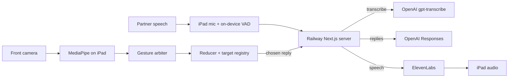

# Still Here

**AI offers possible words. The person decides what to say.**

Still Here is a conversation-first AAC (augmentative and alternative communication) prototype for people who can't speak or use their hands. It runs on a stock iPad using only the front camera: the conversation partner just talks, the app offers a few likely replies, and the person picks one with eyebrow raises and a long blink. The chosen reply is spoken aloud in a natural voice.

> Engineering prototype built in one day. Not a medical device. Not tested with AAC users.

## How it works

```text
Partner just talks (hands-free listening, no button presses)
  → speech is transcribed and shown as "Partner asked"
  → the 2 most likely replies + an "Other ways to answer…" card
  → person moves and chooses with face gestures
  → the chosen reply is spoken in a natural ElevenLabs voice
  → listening resumes (the app never hears itself)
```

| Gesture | Action |
| --- | --- |
| Raise both eyebrows (hold about 0.35-0.5 s, set in calibration) | Next: move one choice |
| Keep eyebrows up | Keep moving, one step every 0.6 s; relax to stop |
| Brief jaw drop (about 0.4-1.5 s, then close) | Back one choice; talking and yawns are ignored |
| Long, deliberate blink (about 1 s) | Choose; normal blinks are ignored |
| Long blink while speaking | Stop speaking |

- **Other ways to answer** shows 3-5 AI-suggested directions (for "How was your day?": Rough day, Mixed day, Not now, You first). Replies for each direction are fetched in the background.
- **None of these** gives new meanings, not paraphrases. **Guide my response** (agree, disagree, ask), **Quick phrases**, and **My words** (spell it out) work without accepting any AI suggestion; Quick phrases and My words need no AI at all.
- **Fast mode** (on by default): one long blink speaks the highlighted reply immediately. Turning it off in setup restores **review + a separate confirming blink**, with review starting on Cancel.
- Fallback inputs: auto-scan + blink, keyboard or single switch, and touch. All inputs go through the same guarded action path.

Full user guide: [docs/manual/QUICK_GUIDE.md](docs/manual/QUICK_GUIDE.md).

## Measured results (with conditions)

**End-to-end latency**, from [docs/evidence/E2E_LATENCY.md](docs/evidence/E2E_LATENCY.md). Measured from a Mac on the venue network against the deployed Railway server by `scripts/e2e-latency.mjs`, using **synthetic speech** (macOS `say`). It **excludes the person's reading and gesture time** and is **not measured on the iPad**. 10 runs (40 API calls) per side, 0 failures. One sample per side, not a controlled A/B.

| | Before median | After median | Before p90 | After p90 |
| --- | --- | --- | --- | --- |
| Partner stops → suggestions on screen | 5.07 s | 3.85 s | 7.78 s | 5.75 s |
| `/api/replies` (3 suggestions) | 3.87 s | 2.55 s | 6.65 s | 4.40 s |
| `/api/transcribe` | 0.52 s | 0.65 s | 0.66 s | 0.73 s |
| Blink → voice, without prefetch (full MP3) | 0.69 s | 0.63 s | 0.80 s | 0.72 s |

With prefetch, blink → voice is about 0 **only if** reading plus blinking takes longer than the voice fetch (median 0.63 s). The script does not measure human reading time. Open-ended questions such as "How was your day?" with Other ways to answer can take 7-9 s; concrete questions 2.4-3.7 s (same Mac conditions).

**Automated tests:** `npx vitest run` at 2:30 PM CT: **586 passed + 2 expected fail** (`it.fails` documenting two known bugs in the auto-scan fallback mode). These are unit, API, and synthetic-frame pipeline tests with mocked providers, not hardware or live-provider checks.

**Smoke test:** `node scripts/smoke-deployed.mjs` against the deployed server: 6/6 pass (page, status, replies, speech, transcription, Permissions-Policy header).

**Live AI behavior:** 14 of 14 synthetic scenarios returned valid reply batches; the model kept disagreement, did not follow an embedded prompt injection, and offered no consent on a medication question ([docs/evidence/live-scenarios-review.md](docs/evidence/live-scenarios-review.md)). Reviewed by Claude, not by humans.

**On the physical iPad (iPad Air 13" M2, iPadOS 27.2):**

| Verified | Not yet verified |
| --- | --- |
| Native app builds, signs, installs, and launches | Eyebrow and blink reliability (the 20-raise / 20-blink `/trial` run has not been run) |
| Capability check: front camera, WebGL2, wake lock, audio session, recording | Hold-to-move, jaw-drop Back, and Other ways to answer tested by a person |
| Live suggestions from the iPad in 3.6 s; voice MP3 in 0.6 s; MediaPipe GPU start in 0.8 s | Multi-face lock, audible prefetch, follow-up merge on device |
| Hands-free conversation end to end (team-reported manual test, about 1:20 PM) | Network check proving camera frames never leave the device |

Full log: [docs/TEST_RESULTS.md](docs/TEST_RESULTS.md).

## Privacy and safety

- **Camera:** frames are processed on the iPad by MediaPipe Face Landmarker (model and WASM served from our own origin) and are never uploaded or recorded, by design. Only eyebrow, eye-closure, and jaw scores and a face count are produced. No face recognition, gaze tracking, or emotion inference. The on-device network check has not been run, so this is a design claim, not a verified one.
- **Partner audio:** while hands-free listening is on, utterance clips cut by on-device voice detection are sent to OpenAI transcription. Anyone speaking near the iPad is transcribed. **Stop listening** turns it off.
- **Conversation text:** sent to the OpenAI Responses API with `store: false`. OpenAI may retain abuse-monitoring logs up to 30 days; we make no zero-retention claim.
- **Voice:** in fast mode, the suggested sentences on screen are sent to ElevenLabs ahead of time (including ones never chosen) so the chosen one plays quickly. In review mode only the confirmed sentence is sent. Prebuilt voice, no cloning. No zero-retention claim.
- **Nothing is spoken unless the person chooses it.** A wrong transcript produces wrong suggestions, never speech by itself. Fast mode trades the review step for speed; a stray long blink could speak the highlighted reply. **Stop** (long blink while speaking) and **Pause** are always available.
- Keys stay on the server; none use a `NEXT_PUBLIC_` prefix. Server logs are content-free.
- **Not a medical, legal, or emergency tool.** Details: [docs/PRIVACY_AND_LIMITATIONS.md](docs/PRIVACY_AND_LIMITATIONS.md).

## Architecture

- **Web app:** Next.js 16 (App Router), React 19, TypeScript, zod. One pure reducer (`src/core/reducer.ts`) makes every decision, and one target registry (`src/core/targets.ts`) defines what can be selected. Touch, keyboard, switch, blink, and eyebrow input all reach the same guarded `ACTIVATE` path.
- **Gestures:** MediaPipe FaceLandmarker (`@mediapipe/tasks-vision` 1.1.1, local WASM + model in `public/`). Pure gesture logic in `src/access/`; `src/access/gesture-arbiter.ts` is the only emitter of accepted commands (blink always wins; ambiguous input is discarded).
- **Replies:** OpenAI Responses API, `gpt-6-astra`, strict JSON schema, no tools, output validated server-side.
- **Speech to text:** OpenAI `gpt-transcribe`.
- **Voice:** ElevenLabs `eleven_v4_turbo`, server-side only (`src/server/elevenlabs/`).
- **Backend:** Railway, single instance. Paid routes require an access code (`x-still-here-access` header), with per-client rate limits and a daily voice character budget.
- **iPad shell:** SwiftUI + WKWebView in `ipad-shell/` (xcodegen `project.yml`, iPadOS 18+, landscape). Loads the deployed app full screen with audio unlocked and camera/microphone granted for its own site.



More: [docs/ARCHITECTURE.md](docs/ARCHITECTURE.md), [docs/DECISIONS.md](docs/DECISIONS.md).

## Run it locally

Prerequisites: Node.js 24 (`engines: >=24 <25`), npm, and Python 3.10+ for `npm run check`. Camera access on an iPad needs an **HTTPS** origin; the laptop's `localhost` is not reachable from the iPad.

```sh
npm install
cp .env.example .env.local   # fill in values locally; never commit them
npm run dev                  # http://localhost:3000 (copies MediaPipe WASM into public/wasm)
npx vitest run               # unit, API, and synthetic pipeline tests
npm run check                # typecheck + lint + tests + repo hygiene
```

With empty keys the app runs in a labeled **Fixture demo** mode (scripted suggestions) or **Local only** mode. Gesture detection needs no variables.

Environment variable names (see [.env.example](.env.example); values go only in `.env.local` or Railway variables):

| Variable | Purpose |
| --- | --- |
| `AI_PROVIDER`, `OPENAI_API_KEY`, `REPLY_MODEL`, `REPLY_REASONING_EFFORT` | Live replies (`openai` verified; `ANTHROPIC_API_KEY`, `REPLY_FALLBACKS` for an unverified Anthropic adapter) |
| `TRANSCRIPTION_PROVIDER`, `TRANSCRIPTION_API_KEY`, `TRANSCRIPTION_MODEL`, `TRANSCRIPTION_BASE_URL` | Partner speech to text |
| `ELEVENLABS_API_KEY`, `ELEVENLABS_VOICE_ID`, `ELEVENLABS_MODEL_ID`, `ELEVENLABS_OUTPUT_FORMAT`, `ELEVENLABS_TIMEOUT_MS`, `ELEVENLABS_TRANSPORT`, `ELEVENLABS_ALLOWED_VOICE_IDS`, `ELEVENLABS_DAILY_CHAR_BUDGET` | Natural voice (server only) |
| `FIXTURES_ENABLED` | Allow the labeled fixture demo mode |
| `GENERATION_TIMEOUT_MS`, `TRANSCRIPTION_TIMEOUT_MS`, `MAX_AUDIO_BYTES` | Request budgets |
| `APP_ACCESS_TOKEN` | Access code for paid endpoints; required for any non-local deployment |

**Deploy:** `railway up --service api` from a checkout (a Git push does not deploy). Runbook: [docs/DEPLOYMENT.md](docs/DEPLOYMENT.md).

**iPad shell:** `scripts/build-ipad-shell.sh [device-udid]` runs xcodegen, builds, installs, and launches on a registered iPad. It needs Xcode, xcodegen, and Apple development signing. The access code is generated into the gitignored `ipad-shell/StillHereShell/DemoSecrets.swift` from the gitignored `.env.railway.local`; without it, the app asks for the code at setup. Safari or an iPad Home Screen web app also work ([docs/IPAD_HOME_SCREEN.md](docs/IPAD_HOME_SCREEN.md)).

## Limitations and next steps

- **One-person engineering trials only.** No AAC users, people with ALS, clinicians, or SLPs have tested it. No clinical validation.
- **Gesture reliability is not measured** with real users. Lighting, glasses, camera angle, fatigue, and individual motor ability will affect it, and not everyone can raise their eyebrows or blink on purpose (hence touch, switch, and scan fallbacks).
- **Latency:** open-ended questions can take about 7-9 s to produce suggestions (Mac to deployed server, synthetic).
- **Noisy rooms:** other voices may be transcribed as partner lines. Use Stop listening and type instead.
- English only. No offline guarantee. Accessibility (VoiceOver, Dynamic Type, contrast) not audited. The MediaPipe model cards say the models are not intended for life-critical decisions.

**Next:** testing and co-design with AAC users and speech-language pathologists; the measured `/trial` reliability study; on-device transcription and suggestion models to cut latency and cloud exposure; a personal voice made with the person's consent.

## Team and AI use

Built at **SASEHacks for Good 2026** (University of Oklahoma, October 24, 2026). Hacking began at 09:00 CT.

Team: Liam Howeth, ...

Built with AI coding assistants, **Claude Code and Codex**, directed and reviewed by the team. Details: [docs/AI_USAGE.md](docs/AI_USAGE.md).

**Related work:** conversation-first AI-assisted AAC and camera-based AAC already exist (VisioALS, Google SpeakFaster, Project Converse / DEAN, Speak4Me, Bobbai). We do not claim a first; our contribution is this implemented combination. No code or assets were copied. See [docs/REFERENCES.md](docs/REFERENCES.md).

**Licenses and attribution:** No project license chosen yet. Third-party: `@mediapipe/tasks-vision` WASM runtime and the MediaPipe Face Landmarker model (`float16/1`), both Apache-2.0, served locally (sources and hashes in `public/models/README.md`). Atkinson Hyperlegible typeface (Braille Institute), loaded via `next/font/google`. ElevenLabs and OpenAI are remote APIs; no provider code or audio is included. Fixtures are synthetic.

## Repo map

| Path | Contents |
| --- | --- |
| `src/core/` | Reducer, target registry, state |
| `src/access/` | Blink, eyebrow, jaw gesture logic and arbiter |
| `src/runtime/` | Browser effects, camera, audio adapters |
| `src/server/`, `src/app/api/` | Provider adapters, access guards, API routes |
| `src/app/trial/` | Engineering gesture-trial recorder (not clinical) |
| `src/tests/` | vitest suites |
| `ipad-shell/` | Native SwiftUI + WKWebView iPad shell |
| `ios/` | Experimental native client, not part of the demo |
| `scripts/` | iPad build, smoke test, latency and scenario scripts |
| [docs/manual/QUICK_GUIDE.md](docs/manual/QUICK_GUIDE.md) | User guide (also PDF in `docs/manual/`) |
| [docs/TEST_RESULTS.md](docs/TEST_RESULTS.md), [docs/evidence/](docs/evidence/) | Executed checks and raw evidence |
| [docs/PRIVACY_AND_LIMITATIONS.md](docs/PRIVACY_AND_LIMITATIONS.md) | Data paths and limits |
| [docs/JUDGE_QA.md](docs/JUDGE_QA.md), [docs/PRESENTATION_NOTES.md](docs/PRESENTATION_NOTES.md) | Judge Q&A and evidence-tagged pitch facts |
| [docs/DEPLOYMENT.md](docs/DEPLOYMENT.md), [docs/IPAD_HOME_SCREEN.md](docs/IPAD_HOME_SCREEN.md) | Deployment and iPad install |
| [AGENT_NOTES.md](AGENT_NOTES.md), [AGENTS.md](AGENTS.md), [CLAUDE.md](CLAUDE.md) | AI agent rules and handoff notes |
